# Diagrama de arquitectura objetivo (Azure + Databricks + ADLS + Unity Catalog + GitHub)

```mermaid
flowchart LR
  subgraph FUENTES["Fuentes"]
    CRM[(CRM<br/>clientes)]
    CORE[(Core pólizas<br/>y siniestros)]
    PAG[(Pagos<br/>recaudos)]
    BUS[[Bus de eventos<br/>movimientos]]
    API[APIs externas]
  end

  subgraph INGESTA["Ingesta"]
    ADF[Azure Data Factory /<br/>Lakeflow Connect<br/>batch + CDC]
    EH[Event Hubs / Kafka]
    AL[Auto Loader<br/>Structured Streaming]
  end

  subgraph LAGO["ADLS Gen2 + Delta Lake (por ambiente)"]
    LAND[/Volumen landing<br/>raw/]
    BR[(BRONZE<br/>copia fiel + metadatos)]
    SI[(SILVER<br/>estándar, dedup, calidad)]
    QU[(Cuarentena)]
    GO[(GOLD<br/>productos de datos)]
  end

  subgraph PROC["Procesamiento – Databricks"]
    JOB[Lakeflow Jobs<br/>día 5 · 06:00 COT]
    DQ[Motor de reglas<br/>contratos · reconciliación]
  end

  subgraph GOB["Gobierno y seguridad"]
    UC[Unity Catalog<br/>linaje · permisos · tags · máscaras]
    KV[Azure Key Vault /<br/>secret scopes]
    ENTRA[Entra ID<br/>grupos · service principals]
  end

  subgraph OBS["Observabilidad"]
    CTL[(ctl_* · gold_calidad_pipeline)]
    DASH[AI/BI Dashboard<br/>SLA · frescura · calidad · costo]
    ALR[Alertas<br/>correo · Teams · PagerDuty]
    SYS[(System tables<br/>billing · audit · lineage)]
  end

  subgraph CONSUMO["Consumo"]
    VW[Vistas certificadas]
    BI[Power BI / Databricks SQL]
    ML[ML / Feature store]
    GENAI[Genie / agente GenAI gobernado]
    OPS[Aplicaciones operativas]
  end

  subgraph DEVOPS["CI/CD"]
    GH[GitHub<br/>PR · revisión · ramas]
    GHA[GitHub Actions<br/>lint · pruebas · bundle]
    ENV{{DEV → QA → PROD<br/>aprobación manual}}
  end

  CRM & CORE & PAG --> ADF --> LAND
  API --> ADF
  BUS --> EH --> AL --> BR
  LAND --> BR --> SI --> GO
  SI -.rechazos.-> QU
  JOB --> BR & SI & GO
  DQ --- SI & GO
  GO --> VW --> BI & ML & GENAI & OPS
  UC -.gobierna.- LAND & BR & SI & GO & VW
  KV -.credenciales.- ADF & JOB
  ENTRA -.identidades.- UC
  JOB --> CTL --> DASH --> ALR
  SYS --> DASH
  GH --> GHA --> ENV --> JOB
```

**Implementación de la prueba (Free Edition):** un único workspace; `workspace.default.volume1/raw` como landing;
tablas Delta administradas `bronze_*`, `silver_*`, `gold_*`, `ctl_*` en `workspace.default`; Workflow serverless;
GitHub con CI. Los componentes ADF, Event Hubs, Key Vault, Entra ID y ambientes separados forman parte de la
arquitectura objetivo corporativa.
